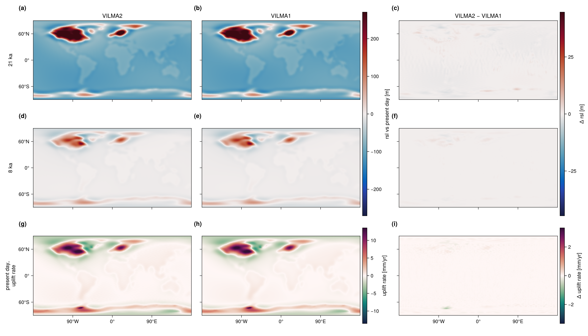

::: {.callout-warning appearance="minimal"}
**Pre-publication page.** This page is not linked from the navigation and is
excluded from the site search. It is reachable by direct link only.
:::

::: {.callout-note appearance="minimal"}
**Reference:** VILMA1 [@Martinec2000; @Martinec2018], run through VILMA2's own
driver with `solver = "v1"`. **Earth structure:** the 3-D viscosity field of
@Bagge2021 and its radial mean. **Driver:** `vilma.x` (not in `make check`;
needs a VILMA1 install). **Status:** ✅ run at $\ell_\max = 170$, model f0c4678,
albedo. The numbers below are from `validation/tables/` of that pass.
:::

This page compares VILMA2 with VILMA1 on the last deglaciation. Both solvers
run behind the same driver, so they share the ice forcing, the remap, the
reference state, the output grid and the output file layout. The comparison is
a change of one namelist key, `solver = "v2"` or `solver = "v1"`. It tests the
complete model at production resolution: the visco-elastic response with 3-D
viscosity, the sea-level equation with migrating coastlines, and the rotational
feedback.

It is a code-to-code comparison, not a comparison with a reference solution.
Agreement shows that the two codes solve the same problem in the same way. It
does not bound the error that both codes share.

## Experiment design

The settings below are common to both solvers unless stated. They are set in
`validation/experiments/nml/blockD.nml.tmpl` and `blockDV1.nml.tmpl`.

| item | setting |
|---|---|
| Ice forcing | GLAC-1D ice thickness, `input/geo_ice_glac1d_deglac.nc`, 26 ka to present, 261 slices every 100 yr |
| Ice density | 931 kg m⁻³ (the value of the earlier reference results; the model default is 917) |
| Coupling and output grid | $\ell_\max = 170$, Gauss grid of VILMA2 |
| VILMA1 internal grid | `vilma_v1_jmax = 170`, 512 × 256 |
| Reference state | `i_eq = 2`, VILMA2's LGM reference state, the same file for both solvers |
| Viscosity, case 3-D | the field of @Bagge2021 on longitude, latitude and radius, with VILMA2's clamp applied ($10^{19.5}$ to $10^{30}$ Pa s) |
| Viscosity, case 1Db | the radial mean of that field (the geometric mean per level) |
| Degree-1 frame | center of mass in both (`deg1_frame = "cm"`) |
| Radial elastic structure | PREM geometry in 11 layers, VILMA2's layer table, also given to VILMA1 |
| Radial mesh | the 5/10/40 km element spacing of VEGA in both. VILMA2: 220 elements including the fluid core (`mesh_depth = 80e3, 670e3`), 82 of them 3-D. VILMA1: 128 mantle and lithosphere elements, from a `densi.inp` written from VILMA2's layer table |
| Ice and water density | VILMA2's values, also written to VILMA1's load file |
| Rotation | on in both |
| Coastlines | migrating, with the subgrid (water-column) ocean load |
| VILMA2 time stepping | `scheme = "fe"`, equal sub-steps at the Maxwell stability limit within the 100 yr interval |
| VILMA1 time stepping | `vilma_v1_nsub = 12` uniform sub-steps of 8.33 yr |
| Toroidal field | off (`l_toroidal = .false.`), the model default |

**Reference state.** The reference is built once, by VILMA2 with the 3-D
viscosity. The 26 ka ice load is held for 30 kyr from rest
(`equil_time_max = 30000`, `equil_rate_tol = 0`, no 1-D pre-spin-up, lid rule
off). The result is not an equilibrium, because the stiffest parts of the
viscosity field keep relaxing. The fixed duration makes the state reproducible.
Both solvers start from this state, so the load anomaly is zero at the start
for both. VILMA1 requires this: it starts with zero load anomaly and zero
viscous memory. Neither solver runs a spin-up in the comparison itself
(`equil_time_max = 0`, `pre_spinup_1d = .false.`).

**Viscosity.** VILMA1 reads its viscosity file directly and applies no clamp of
its own. The file it reads is therefore written from VILMA2's clamped field, on
the 128 radial elements that VILMA1 uses. VILMA1 maps the file's levels onto its
elements by index, not by radius, so the staging script checks that the file
has one level per element. The 1Db case uses the radial mean of the same field
in both solvers, so the 3-D and 1Db cases differ only by the lateral variation.

**VILMA1 sub-steps.** VILMA1 does not sub-step by itself, and it stops if the
step exceeds its Maxwell limit. The limit measured for this structure is
11.0 yr, which gives 12 sub-steps per 100 yr interval.

**Shared diagnostics.** The ocean function `C_ocean` and the barystatic sea
level `bsl` are computed by VILMA2's routines from the state of each solver.
They are not independent between the two solvers.

## The experiment

{#fig-deglac-maps}

The ocean-mean relative sea level at present day, relative to the reference
state, is 96.90 m (3-D) and 97.06 m (1Db). This is 102.9 % and 103.2 % of the
above-flotation volume of the reference ice that is lost, 94.21 m and 94.08 m
in barystatic metres, both rebuilt from the run's own output. The lateral
viscosity changes relative sea level by 17.2 m RMS at 21 ka (3-D minus 1Db, at
most 249 m) and the present-day uplift rate by 0.63 mm/yr RMS (at most
24.2 mm/yr).

## Results

Relative sea level (RSL) is taken relative to each run's own present day. The
difference is VILMA2 minus VILMA1. All statistics are over the global grid. The
difference is therefore zero at present day by construction, and present day is
covered by the uplift rate instead.

| time | RMS [m] | max \|Δ\| [m] | 99th pct [m] | VILMA2 signal max [m] | RMS / signal | deg 0 [m] | \|deg 1\| [m] | RMS after deg 0+1 [m] |
|---|---:|---:|---:|---:|---:|---:|---:|---:|
| 21 ka | 5.138 | 87.664 | 18.016 | 463.3 | 1.11e-02 | 0.50 | 0.36 | 5.120 |
| 14 ka | 4.618 | 91.394 | 16.772 | 427.4 | 1.08e-02 | 0.52 | 0.30 | 4.593 |
| 8 ka | 2.131 | 32.929 | 8.019 | 185.0 | 1.15e-02 | 0.23 | 0.18 | 2.122 |
| 2 ka | 0.382 | 6.012 | 1.494 | 45.8 | 8.35e-03 | 0.03 | 0.04 | 0.382 |

: RSL difference, VILMA2 minus VILMA1, 3-D viscosity. {#tbl-deglac-3d}

| time | RMS [m] | max \|Δ\| [m] | 99th pct [m] | VILMA2 signal max [m] | RMS / signal | deg 0 [m] | \|deg 1\| [m] | RMS after deg 0+1 [m] |
|---|---:|---:|---:|---:|---:|---:|---:|---:|
| 21 ka | 0.626 | 6.276 | 1.811 | 425.5 | 1.47e-03 | -0.28 | 0.06 | 0.557 |
| 14 ka | 0.477 | 4.135 | 1.825 | 379.0 | 1.26e-03 | -0.09 | 0.03 | 0.467 |
| 8 ka | 0.235 | 3.191 | 1.011 | 229.4 | 1.02e-03 | -0.02 | 0.02 | 0.233 |
| 2 ka | 0.045 | 0.703 | 0.181 | 31.6 | 1.42e-03 | 0.00 | 0.00 | 0.045 |

: RSL difference, VILMA2 minus VILMA1, 1Db viscosity (radial mean of the 3-D field). {#tbl-deglac-1d}

With the radial-mean viscosity the two codes agree to 0.2 % of the RSL signal
throughout; the RMS difference is at most 0.66 m (24 ka). With the 3-D
viscosity they agree to 1.4 % at most; the RMS difference peaks at 5.29 m
(23 ka). The degree-0 and degree-1 parts of the difference stay at or below about
0.5 m in both pairs, and removing them changes the RMS by less than 0.07 m.

| quantity | 3-D | 1Db |
|---|---:|---:|
| Present-day uplift rate, RMS difference [mm/yr] | 0.1832 | 0.0296 |
| Present-day uplift rate, max difference [mm/yr] | 2.7464 | 0.8907 |
| Present-day uplift rate, 99th pct difference [mm/yr] | 0.7140 | 0.0915 |
| Present-day uplift rate, VILMA2 signal max [mm/yr] | 38.36 | 15.54 |
| Present-day uplift rate, RMS / signal | 4.78e-03 | 1.91e-03 |
| Barystatic sea level, max difference over the run [m] | 0.367 | 0.238 |
| Barystatic sea level, difference at present day [m] | 0.349 | 0.232 |
| Ocean-mean RSL at present day, VILMA2 [m] | 96.90 | 97.06 |
| Ocean-mean RSL at present day, VILMA1 [m] | 96.55 | 96.83 |
| Ocean-mean RSL at present day, difference [m] | 0.35 | 0.23 |

: Present-day uplift rate and global-mean quantities, VILMA2 against VILMA1. {#tbl-deglac-scalars}

| time | 3-D: cells differing | 3-D: % of grid | 1Db: cells differing | 1Db: % of grid |
|---|---:|---:|---:|---:|
| 21 ka | 7 | 0.003 | 4 | 0.002 |
| 14 ka | 70 | 0.030 | 17 | 0.007 |
| 8 ka | 267 | 0.115 | 52 | 0.022 |
| 2 ka | 333 | 0.143 | 50 | 0.021 |
| 0 ka | 363 | 0.156 | 58 | 0.025 |

: Grid cells on which the ocean functions of the two runs differ. {#tbl-deglac-ocean}

For scale, the lateral-viscosity signal within VILMA2 (3-D minus 1Db: 17.2 m
RMS at 21 ka, 15.0 m at 14 ka, 6.2 m at 8 ka) is three times the difference
between the codes with the 3-D viscosity, and about thirty times the difference
with the 1Db viscosity.

## Figures

![VILMA2 against VILMA1 with the 3-D viscosity of Bagge et al. (2021). Both codes solve the same problem: the same GLAC-1D forcing, reference state, viscosity field, grid ($\ell_\max = 170$) and degree-1 frame. (a, d, g) VILMA2. (b, e, h) VILMA1. (c, f, i) VILMA2 minus VILMA1. The top and middle rows show relative sea level at 21 ka and 8 ka, relative to each run's own present day. The bottom row shows the present-day uplift rate of the bedrock. The two model columns share a color scale. The difference column has its own, narrower scale. Model f0c4678, albedo.](figures/deglac-v2v1-maps-3d.png){#fig-deglac-v2v1-maps-3d}

{#fig-deglac-v2v1-maps-1d}

![Size and composition of the difference in relative sea level, VILMA2 minus VILMA1, through the last deglaciation, for the 3-D viscosity (red) and the 1Db viscosity (blue), at $\ell_\max = 170$ on the same reference state. (a) RMS difference over the global grid. (b) The same, as a percentage of the largest absolute relative sea level that VILMA2 produces at that time. (c) The degree-0 (solid) and degree-1 (dash-dotted) parts of the difference, from an area-weighted least-squares fit. (d) Fraction of grid cells on which the ocean functions of the two runs differ. Sea level is relative to each run's own present day, so the difference is zero at 0 ka and (b) is undefined there. Model f0c4678, albedo.](figures/deglac-v2v1-summary.png){#fig-deglac-v2v1-summary}

The two maps figures use a separate color scale for the difference column. On
the scale of the model columns, the difference would not be visible. The
summary figure shows the difference through time, and its panel (c) is the
check that the degree-1 frame is matched.

## Sources of difference

### 1. Load path within a coupling interval

The two solvers reach the same load at the end of each 100 yr interval by
different paths. VILMA2 ramps the load linearly across the interval and takes
equal sub-steps at its own Maxwell stability limit. VILMA1 holds the load at
the value of the interval and takes 12 uniform sub-steps of 8.33 yr. The
difference is first order in the coupling interval. Its size has not been
measured in isolation. An earlier test bounds the sub-step part alone: with 24
and 48 sub-steps, VILMA1's result changed by 0.006 m.

### 2. Radial discretisation and lateral viscosity

The two codes integrate the same viscosity field and the same elastic layer
table on their own radial element grids, with the same target spacing but not
the same nodes: VILMA2 spreads the elements of a layer evenly, VILMA1 truncates
each layer to whole elements. With lateral variation, each code also carries it in its own way;
VILMA2 treats only the elements whose lateral spread exceeds `visc3d_tol =
1e-3` as 3-D (82 of 220). The lateral variation is the only difference between
the 3-D and the 1Db pair, and the 3-D pair differs about eight times more. The residual of the 3-D pair is not a low-degree pattern: at
21 ka the largest single part up to degree 8 is degree 6, order 2, at 0.70 m of
an area-weighted RMS of 4.08 m, so most of it lies above degree 8. The maps
place it along the margins of the ice sheets and the steep viscosity gradients
of the cratonic keels.

### 3. Degree-1 frame

The two codes must report RSL in the same degree-1 frame. VILMA1 works in the
center-of-mass frame and carries geocenter motion in its RSL. With
`deg1_frame = "cm"` in VILMA2 the frames are matched; panel (c) of
@fig-deglac-v2v1-summary shows the degree-1 part of the difference stays below
0.38 m (3-D) and 0.08 m (1Db). Unmatched, degree 1 was about half of the
difference in this experiment and 98 to 99.7 % of it in a disc-load test.

### 4. Rotational feedback (resolved)

Earlier passes (model 907bc74) were dominated by one pattern of degree 2 and
order 1, the pattern of the rotational feedback. Three fixes to VILMA2's
rotation (304f4cb: the sign of the centrifugal potential, the viscosity of the
relaxation, and the coupling of the rotation within the step) removed it.

| pair | RMS [m] | degree-2, order-1 part [m] | RMS after removing it [m] |
|---|---:|---:|---:|
| 3-D, now | 4.08 | 0.50 | 4.05 |
| 1Db, now | 0.59 | 0.37 | 0.45 |
| 3-D, 907bc74 | 8.91 | 7.74 | 4.41 |
| 1Db, 907bc74 | 7.93 | 7.86 | 1.04 |

: Degree-2, order-1 content of the RSL difference at 21 ka, area-weighted. {#tbl-deglac-y21}

VILMA1 does not write its polar motion through this driver, so the two codes
are not compared on polar motion here. VILMA2's polar motion over the run is
between −2.1e-3 and 2.3e-4 (dimensionless, both components, both structures).

## How to reproduce

The experiment pipeline lives in the repository's
[`validation/`](https://github.com/fesmc/vilma2/tree/main/validation) directory.
It stages the forcing, the reference state and the matched viscosity files,
runs both solvers, reduces their output, and writes the tables
(`validation/tables/`) and the figures on this page. `validation/RESULTS.md`
records the model commit and the jobs of each pass.

```bash
cd validation
./run.sh build              # model, benchmark drivers, VILMA1-backend binary
./run.sh ref                # LGM reference state
./run.sh submit prep        # export the reference, write the shared viscosity files
./run.sh D V1               # VILMA2 and VILMA1, 3-D and 1Db
./run.sh submit reduce analyse
```

The VILMA1 runs need a build with `vilma_v1=1` and a VILMA1 install. VILMA1 is
a precompiled library and is not a dependency of the default build. The build,
the namelist keys and the constraints are described in
[`doc/vilma-v1-backend.md`](https://github.com/fesmc/vilma2/blob/main/doc/vilma-v1-backend.md).
`examples/deglac_vilma_v1.nml` is a low-resolution template for the backend. It
is not the configuration of this page.
