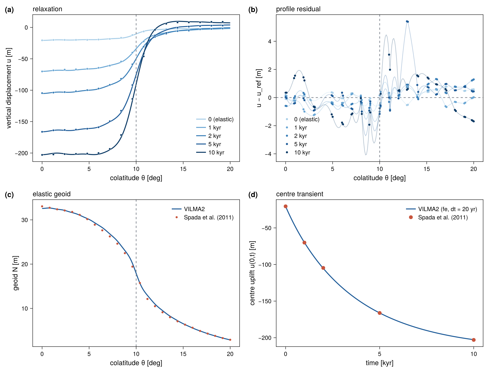

::: {.callout-note appearance="minimal"}
**Reference:** Spada et al. (2011), disc-load test, earth model **M3–L70–V01**
[@Spada2011]. **Test:** `test_benchmark_disc` (in `make check`). **Asserted:**
elastic profile within 6 % (uplift) and 4 % (geoid) of the peak, away from the
disc edge; center uplift within 3 % at 1, 2, 5 and 10 kyr. **Measured** (ifx,
albedo): 4.0 % and 2.8 % for the elastic profile; 0.02–0.6 % for the center
uplift.
:::

This benchmark integrates the per-degree response over a **spatial load** and
adds the **time relaxation**, testing the spatial synthesis and the Maxwell
stepper together against a spatial reference.

## Load and setup

- A **10° radius disc** of **1000 m ice** ($\rho_{\text{ice}} = 931\
  \mathrm{kg\,m^{-3}}$) on elevated bedrock — **no ocean load**.
- Earth model **M3–L70–V01** (as for the [Love numbers](love-numbers.qmd)).
- The disc is expanded in Legendre coefficients
  $\sigma_n = \tfrac{\sigma_0}{2}\,[P_{n-1}-P_{n+1}]$ and the spatial response is
  synthesized as $u(\theta) = \sum_n U_n(a)\,\sigma_n\,P_n(\cos\theta)$.

## Reference data and metrics

The reference is the spatial response at colatitudes $\theta = 0$:$0.1$:$20°$
(201 points) and times $t = [0,1,2,5,10,100]$ kyr (column 1, $t=0$, is the
elastic response). The reference provides three fields: vertical displacement
$u$, geoid $n$, and uplift rate $\mathrm{d}u/\mathrm{d}t$. The stored curves are
piecewise linear on a 1° grid, which limits how closely any smooth solution can
match them (see `data/benchmarks/PROVENANCE.md`).

The test makes two comparisons.

1. **Elastic profile.** $u(\theta)$ and $n(\theta)$ at $t=0$ over the full
   colatitude range, from the per-degree elastic response summed to degree 256.
   The error is the largest absolute difference divided by the peak of the
   reference profile. A band of ±1° around the disc edge is excluded from the
   assertion, since a truncated spectral sum rings at the discontinuity of the
   load (Gibbs). The error in that band is reported.
2. **Viscoelastic center uplift.** $u(0,t)$ at $t = 1, 2, 5, 10$ kyr, from the
   1-D Maxwell stepper summed over degrees 2–128 with a 20 yr step.

The test does not compare the uplift rate $\mathrm{d}u/\mathrm{d}t$, the
viscoelastic profile away from the center, or the response at $t = 100$ kyr.
The 100 kyr response is left out because the fluid-limit disc sum of the model
lies about 2.6 % below the reference, which is within the scatter of the
benchmark codes but has not been resolved. The viscoelastic profiles are
written to the dump files for inspection.

The reference uses a **mixed reference frame**: displacement in a
center-of-figure-like gauge ($h_1\approx 0$) and geoid with $N_1 = 0$.
VILMA2 reproduces it with `deg1_frame = "cf"`, which keeps the solver's
displacement gauge and drops the degree-1 geoid. The default `"cm"` frame
differs from the reference at degree 1 only (see
[Sea-level equation](../physics/sea-level.qmd#reference-frame-and-degree-1)).

## Result

The numbers below are for model 1790f86 built with ifx on albedo.

| Quantity | Tolerance | Measured |
|---|:-:|---|
| Elastic uplift profile, off-edge | 6 % of peak | 4.0 % (0.83 m of 20.57 m, at $\theta = 18°$) |
| Elastic geoid profile, off-edge | 4 % of peak | 2.8 % (0.93 m of 33.05 m) |
| Elastic uplift, edge band ±1° | reported only | 1.22 m |
| Center uplift at 1 kyr | 3 % | 0.23 % ($-69.96$ m, reference $-70.12$ m) |
| Center uplift at 2 kyr | 3 % | 0.56 % ($-105.25$ m, reference $-104.66$ m) |
| Center uplift at 5 kyr | 3 % | 0.02 % ($-166.19$ m, reference $-166.22$ m) |
| Center uplift at 10 kyr | 3 % | 0.17 % ($-202.66$ m, reference $-203.01$ m) |

: Disc-load benchmark, tolerances and measured differences. {#tbl-disc}

The center uplift of the viscoelastic transient matches the reference to
better than 0.6 % at all four times. The elastic center uplift at $t=0$ in the
same sum (degrees 2–128) differs by 0.5 % ($-20.67$ m, reference $-20.57$ m)
and is reported but not asserted. The largest off-edge difference of the
elastic uplift profile is in the far field at $\theta = 18°$, where the signal
itself is small. The elastic profile tolerances are therefore loose compared
with the Love-number agreement: they bound the Gibbs ringing of the truncated
sum and the 1° sampling of the reference, not the per-degree response.

## Figures

<!-- FIGURE (enable when figures/disc.png exists)
{#fig-disc}
-->

With `VILMA_BENCH_DUMP` set, the test writes `disc_elastic_profile.txt`,
`disc_ve_profile.txt` and `disc_ve_centre_series.txt` (see
[Benchmarks](index.qmd#dumping-the-comparison-data)).

## Provenance

Reference: `data/benchmarks/disc_spada2011/{u,n,dudt}_disc.txt`, from the
`isostasy_data` repository [J. Jereczek], `model_outputs/Spada-2011/`, originating
in the Spada et al. (2011) benchmark. Full details in
`data/benchmarks/PROVENANCE.md`.
