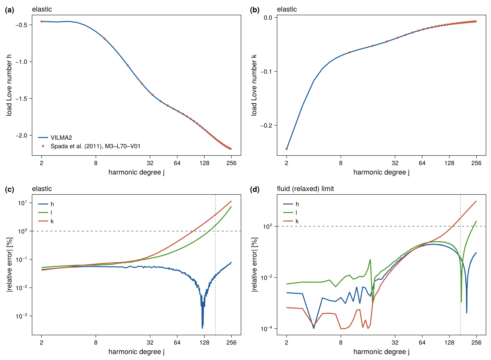

::: {.callout-note appearance="minimal"}
**Reference:** Spada et al. (2011), the Charles University GIA benchmark, earth
model **M3–L70–V01** [@Spada2011]. **Test:** `test_benchmark_love` (in
`make check`). **Asserted:** $h$ and $k$ within 1 % for the elastic numbers at
degrees 2–48, and $h$, $\ell$, $k$ within 1 % for the fluid numbers at degrees
2–8. **Measured** (ifx, albedo): $h$ within 0.08 % at every degree 2–256;
$\ell$ and $k$ leave 1 % above degrees 144 and 96.
:::

This benchmark tests the **per-degree radial solver** in isolation: for a
unit surface load at degree $j$, do the elastic (instantaneous) and fluid
(fully relaxed) loading Love numbers match the reference?

## Earth model

**M3–L70–V01** — incompressible, self-gravitating, layered Maxwell:

- a 70 km **elastic lithosphere** ($\eta\to\infty$),
- three viscous **mantle layers**,
- an inviscid **fluid core** ($\mu=0$).

The layer table (radius, density, shear modulus, viscosity) is the
incompressible model of the Spada et al. (2011) benchmark. VILMA2's
`vilma_earth_structure` reproduces the benchmark's interface gravities, total mass,
and moment of inertia as an independent check before any Love number is computed.

## Definitions

For a degree-$j$ surface load of coefficient $\sigma$, with the load's own
surface potential $\varphi^{L} = 4\pi G\,a\,\sigma/(2j+1)$, the loading Love
numbers are extracted from the surface radial functions (Farrell 1972
normalization, [@Farrell1972]):

$$
h_j = \frac{g_0(a)\,U(a)}{\varphi^{L}}, \qquad
\ell_j = \frac{g_0(a)\,V(a)}{\varphi^{L}}, \qquad
k_j = -\frac{F(a)}{\varphi^{L}} - 1.
$$

The $-1$ in $k_j$ follows from Martinec's $\varphi_1 = F$ being the *total*
perturbation potential, which carries the load's direct potential with the
opposite sign to $\varphi^{L}$ ($F\to-\varphi^{L}$ for a rigid sphere).

## Analytic anchors

Two limits are exact and are checked first (`test_love`, to an absolute
$10^{-3}$ for the fluid limit and $10^{-4}$ for the rigid limit):

- **Fluid** ($\mu\to 0$, homogeneous): $h_j\to-(2j+1)/3$, $k_j\to-1$.
- **Rigid** ($\mu\to\infty$): $h_j,\ell_j,k_j\to 0$.

The fluid limit independently exercises self-gravity, incompressibility, the
Poisson coupling, and the load forcing; the rigid limit checks the shear block
and the $F$ sign.

## Result

The test computes $h$, $\ell$ and $k$ at every degree from 2 to 256 for the
elastic and the fluid limit, and compares them with the reference table. It
asserts agreement within 1 % only over the degree ranges given above. The table
below gives the largest relative error measured in each degree band (model
1790f86, ifx, albedo).

| Limit | Number | 2–8 | 2–48 | 49–96 | 97–144 | 145–200 | 201–256 |
|---|:-:|:-:|:-:|:-:|:-:|:-:|:-:|
| elastic | $h$ | 0.06 % | 0.06 % | 0.05 % | 0.02 % | 0.04 % | 0.08 % |
| elastic | $\ell$ | 0.06 % | 0.15 % | 0.41 % | 1.0 % | 2.8 % | 7.6 % |
| elastic | $k$ | 0.07 % | 0.25 % | 0.99 % | 2.5 % | 5.9 % | 11.7 % |
| fluid | $h$ | 0.003 % | 0.10 % | 0.20 % | 0.19 % | 0.11 % | 0.10 % |
| fluid | $\ell$ | 0.008 % | 0.13 % | 0.25 % | 0.25 % | 0.25 % | 1.6 % |
| fluid | $k$ | 0.001 % | 0.10 % | 0.35 % | 1.1 % | 3.9 % | 9.8 % |

: Largest relative difference from the M3–L70–V01 table per degree band. {#tbl-love}

The vertical Love number $h$ matches the table to better than 0.1 % (elastic)
and 0.2 % (fluid) at every degree. The low degrees, which carry most of the
GIA signal, match to better than 0.1 % in all three numbers. Correct
discretization of the self-gravity $U$–$F$ block is essential for the
low-degree elastic numbers (see the
[typo in @Martinec2000 eq. (81)](../discretization/radial-fe.qmd)).

The relative error of $\ell$ and $k$ grows with degree. The elastic $k$ first
exceeds 1 % at degree 97 and reaches about 12 % at degree 256, and the elastic
$\ell$ first exceeds 1 % at degree 145. Both numbers decay with degree
($|k| < 0.016$ and $|\ell| < 0.0021$ above degree 96), so the absolute
differences stay small: at most $8\times10^{-4}$ in $k$ and $2\times10^{-5}$
in $\ell$. The difference in $k$ is nearly the same in the elastic and the
fluid limit and grows roughly as the square of the degree. It is therefore
independent of the rheology. It is a discretization error of the radial mesh,
not a limit of the reference: halving the element size reduces the error at
degree 256 from 11.7 % to 3.0 % in $k$ and from 7.6 % to 2.0 % in $\ell$, and
halving it again to 0.8 % and 0.5 % (second-order convergence; see the
[mesh convergence table](../discretization/radial-fe.qmd#tbl-mesh)). At the
default mesh (5 km elements above 70 km depth) the short-wavelength $k$ and
$\ell$ are thus resolved to about 1 % up to degree 96 and 144. A finer mesh
(`mesh_dr_scale < 1`) improves them at a cost proportional to the number of
elements.

The practical consequence is limited to the geoid at short wavelength. The
bedrock displacement, which dominates relative sea level, depends on $h$. The
geoid contribution of a degree above 96 is scaled by $1 + k$, which the
difference changes by less than 0.1 %.

`TABOO` (NV=3, CODE=7) served as an independent reference to regenerate the
M3–L70–V01 table.

## Figures

{#fig-love-numbers}

The full comparison table can be written by the test itself: set
`VILMA_BENCH_DUMP` to an existing directory and the test writes
`love_elastic.txt` and `love_fluid.txt` there (see
[Benchmarks](index.qmd#dumping-the-comparison-data)).

## Provenance

Reference table: `data/benchmarks/love_M3-L70-V01/mod_M3-L70-V01`, from the
`giapy` package (MIT) [S. B. Kachuck], originating in the Charles University GIA
benchmark; independently regenerable with TABOO (GPLv3). Full details in
`data/benchmarks/PROVENANCE.md`.
