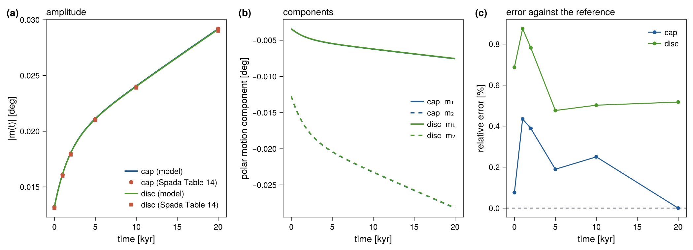

::: {.callout-note appearance="minimal"}
**Reference:** Spada et al. (2011), test 3/2, Table 14, earth model
**M3–L70–V01** [@Spada2011]. **Test:** `test_rotation` (in `make check`).
**Asserted:** rigid inertia within 2 % of the published geometrical factor;
polar motion $|m(t)|$ within 3 % at 0, 1, 2, 5, 10 and 20 kyr, for a cap and a
disc load. **Measured** (ifx, albedo): inertia 0.09 % and 0.41 %; polar motion
within 0.4 % (cap) and 0.9 % (disc).
:::

This benchmark tests the **rotational feedback**: the polar motion excited by
a surface load on a viscoelastic Earth, from the quasi-static Liouville
equation (see [Rotational feedback](../physics/rotation.qmd)).

## Load and setup

- Two axisymmetric ice loads of 10° radius centered at colatitude 25°,
  longitude 75°: a **cap** of 1500 m and a **disc** of 1000 m
  ($\rho_\text{ice} = 931\ \mathrm{kg\,m^{-3}}$), applied as a Heaviside
  load and held for 20 kyr.
- Earth model **M3–L70–V01**, $C - A = 2.63\times10^{35}\ \mathrm{kg\,m^2}$.
- Grid $\ell_\max = 128$, step 25 yr. There is no ocean load: the test drives
  the rotation module directly with the ice load.

## Reference data and metrics

The reference is Table 14 of @Spada2011, the modulus of polar motion $|m|$ in
degrees at six times. The table has two cases. The model integrates the
quasi-static Liouville equation, in which the Chandler wobble is neglected, so
the comparison uses the column with the Chandler wobble excluded ($C_w = 0$).
The values are those of the normal-mode code TABOO. They are tabulated to
three significant digits, which limits the comparison to about 0.4 %. VILMA1
did not contribute polar motion to this test.

The test makes three checks.

1. **Normalization.** The rigid (2,1) inertia of each load, divided by
   $C - A$, reproduces the published geometrical factor $G$ (Spada eq. 31).
   This isolates the mapping from the load to the inertia tensor from the
   viscoelastic response.
2. **Love numbers.** The elastic tidal number $k^T_e$ and the secular number
   $k_s$ lie in the physical range ($0 < k^T_e < k_s$, $0.5 < k_s < 1.5$).
3. **Polar motion.** $|m(t)|$ at the six tabulated times.

## Result

The numbers below are for model 1790f86 built with ifx on albedo. The model
gives $k^T_e = 0.3035$ and $k_s = 0.9667$.

| Load | Rigid inertia $G$ | 0 kyr | 1 kyr | 2 kyr | 5 kyr | 10 kyr | 20 kyr |
|---|:-:|:-:|:-:|:-:|:-:|:-:|:-:|
| cap, model [deg] | | 0.01321 | 0.01617 | 0.01807 | 0.02114 | 0.02406 | 0.02920 |
| cap, reference [deg] | | 0.0132 | 0.0161 | 0.0180 | 0.0211 | 0.0240 | 0.0292 |
| cap, difference | 0.09 % | 0.1 % | 0.4 % | 0.4 % | 0.2 % | 0.3 % | 0.0 % |
| disc, model [deg] | | 0.01319 | 0.01614 | 0.01804 | 0.02110 | 0.02402 | 0.02915 |
| disc, reference [deg] | | 0.0131 | 0.0160 | 0.0179 | 0.0210 | 0.0239 | 0.0290 |
| disc, difference | 0.41 % | 0.7 % | 0.9 % | 0.8 % | 0.5 % | 0.5 % | 0.5 % |
| tolerance | 2 % | 3 % | 3 % | 3 % | 3 % | 3 % | 3 % |

: Polar motion $|m(t)|$ against Spada et al. (2011), Table 14 ($C_w = 0$). {#tbl-rotation}

The polar motion of the cap load matches the reference to within its
tabulated precision. The disc load is about 0.5–0.9 % above the reference at
all times, which is the size of the difference in its rigid inertia (0.41 %)
plus the rounding of the table. The disc has a sharp edge, so its (2,1)
coefficient on the $\ell_\max = 128$ grid is less accurate than that of the
smooth cap.

The benchmark covers the Liouville solve for a prescribed load. The coupling
of the rotational potential into the sea-level equation has no published
benchmark. It is checked for consistency by `test_rotation_sle`
(see [Rotational feedback](../physics/rotation.qmd#validation)).

## Figures

{#fig-rotation}

With `VILMA_BENCH_DUMP` set, the test writes the full trajectory ($m_1$, $m_2$,
$|m|$ every 25 yr) to `rotation_cap_series.txt` and
`rotation_disc_series.txt` (see
[Benchmarks](index.qmd#dumping-the-comparison-data)).

## Provenance

Reference: `data/benchmarks/rotation_spada2011/polar_motion_test3-2.txt` and
`constants_table2.txt`, transcribed from @Spada2011 (Table 14 and Table 2).
Full details in `data/benchmarks/PROVENANCE.md`.
