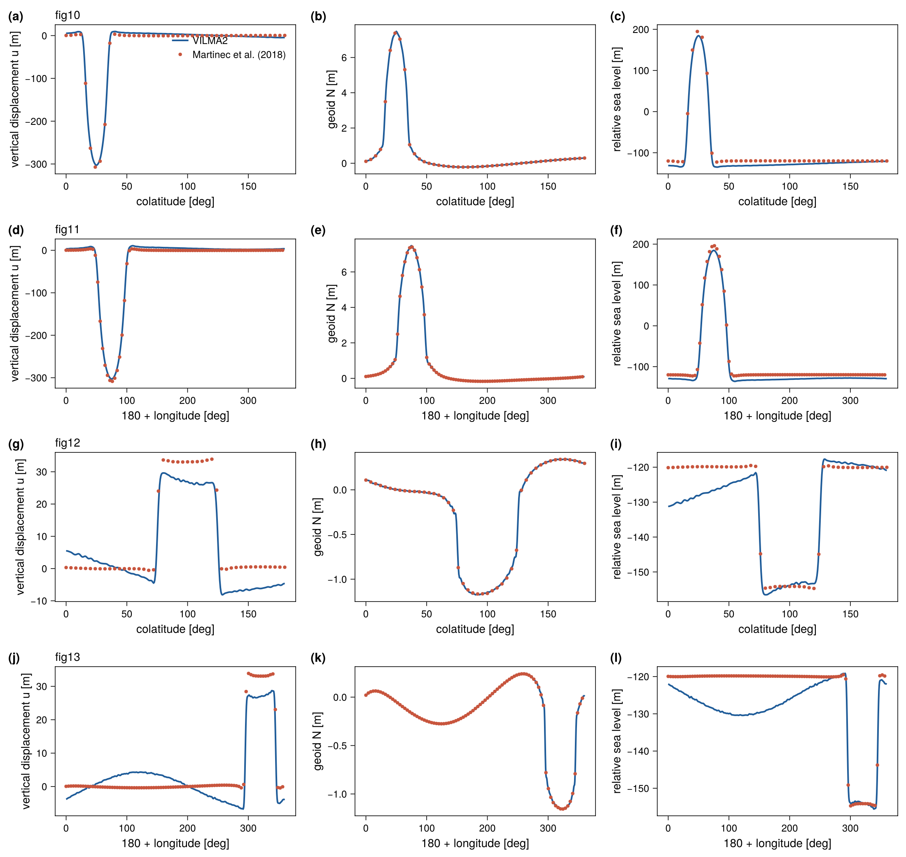
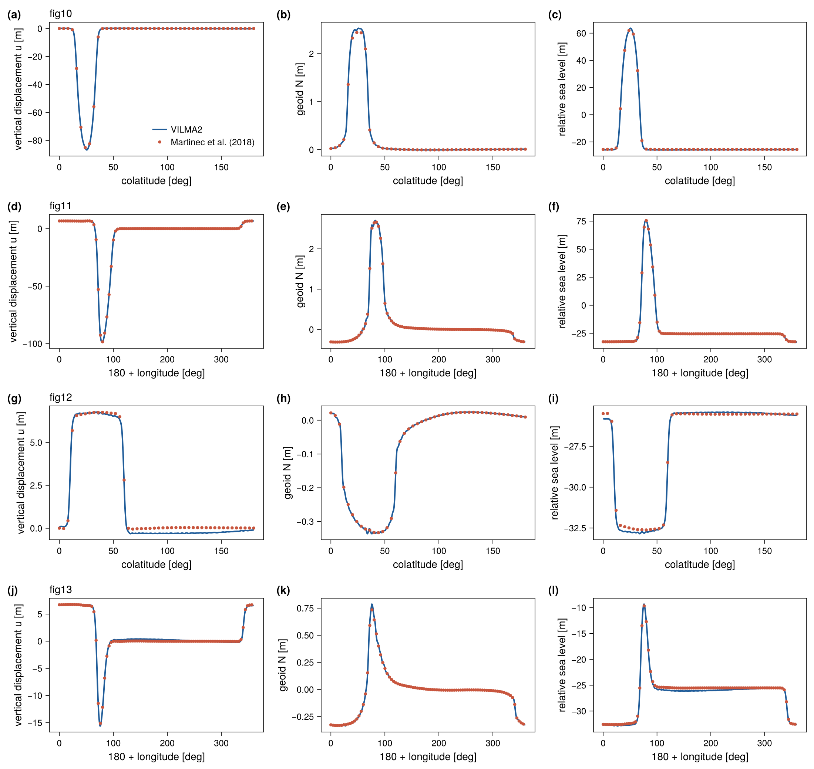
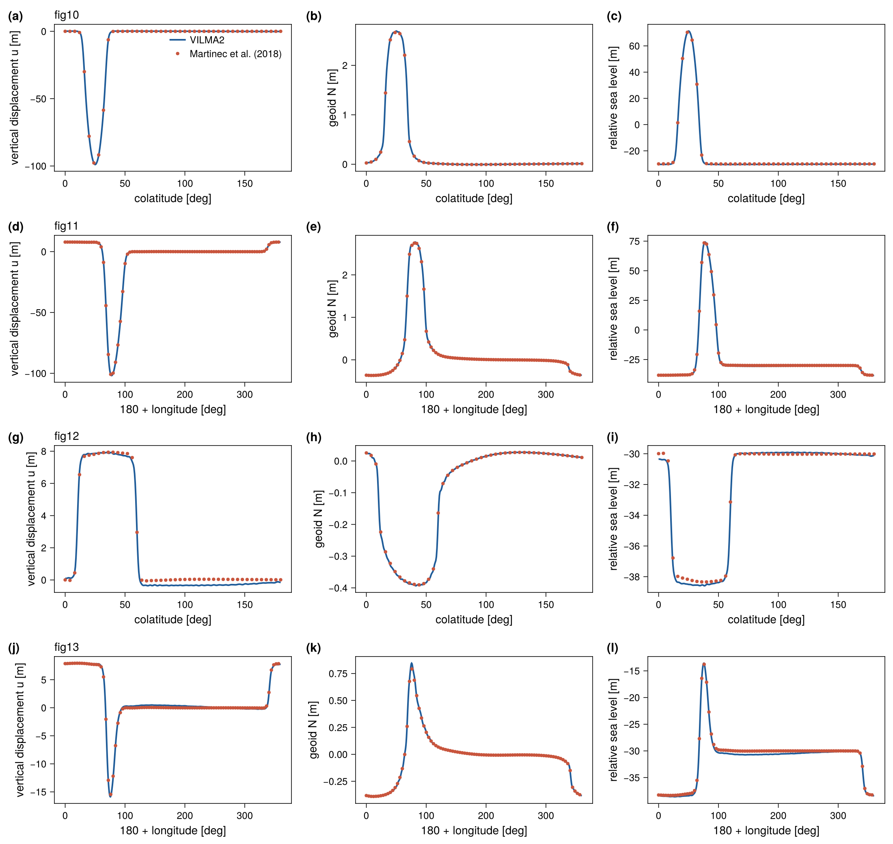
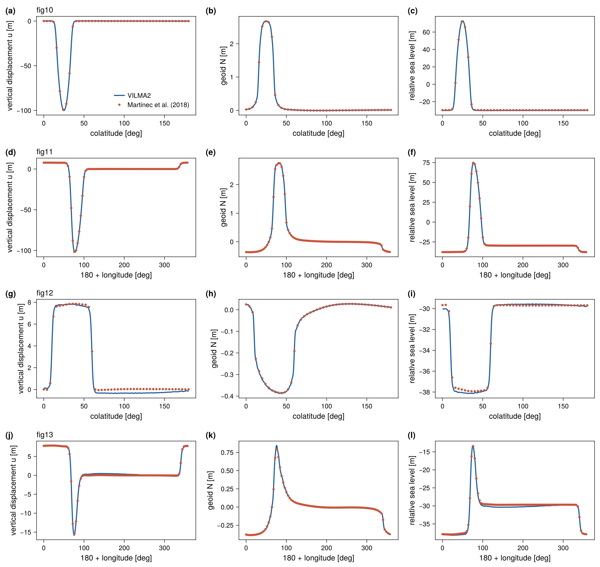

::: {.callout-note appearance="minimal"}
**Reference:** Martinec et al. (2018), the SLE intercomparison [@Martinec2018],
cases A and C2/D3/E2/F1 (SBK reference curves). **Tests:**
`test_benchmark_martinec` (case A, in `make check`) and `test_benchmark_sle`
(the four SLE cases, in `make check-slow`). **Asserted:** case A within 1.5 %
(uplift, horizontal) and 3 % (geoid) of the profile peak; SLE cases within
30 % (uplift), 35 % (horizontal), 12 % (geoid), 8 % (sea surface) and 12 %
(relative sea level) of the profile peak. **Measured** (ifx, albedo): case A
0.5–1.9 %; cases D3, E2 and F1 at most 7.6 %; case C2 up to 28 %, see below.
:::

This benchmark runs the full **self-consistent, migrating-coastline
sea-level equation** driven by the viscoelastic response. It is the benchmark
in which VILMA1 took part. It exercises the ocean function, mass conservation,
coastline migration, grounded-ice flotation, and the sub-grid sloping coast all
together.

## Benchmark structure

The authority for the case definitions is **Martinec et al. (2018), Table 4**
(not the differing case labels in third-party reimplementations). The paper
defines five cases from a small set of building blocks:

- **Ice** (square-root cap $h(\psi) = h_0\sqrt{(\cos\psi-\cos\alpha)/(1-\cos\alpha)}$,
  $\alpha=10°$): **L0** pole/1500 m; **L1** colat 25°/lon 75°, 1500 m; **L2** same
  centre, 500 m.
- **Basin** ($\zeta^{(0)} = b_{\max} - b_0\,e^{-\psi^2/2\sigma^2}$, $\sigma=26°$):
  **B0** none; **B1** colat 100°/lon 320°, shallow (760/1200); **B2** colat 35°/lon
  25°, deep (3800/6000, 2200 m at centre).
- **Time**: **T0** Heaviside (load held, $t_f = 10$ kyr); **T1** linear growth
  over 10 kyr then held to 15 kyr.
- **Ocean**: **SLE0** none; **SLE1** fixed geometry $O^{(0)}$; **SLE2**
  time-varying (migrating coastline).
- Densities $\rho_{\text{ice}}/\rho_{\text{water}} = 931/1000\ \mathrm{kg\,m^{-3}}$,
  $g_0 = 9.815\ \mathrm{m\,s^{-2}}$.

The vendored SBK reference files use a labelling offset by one letter from the
paper (SBK letter = paper letter + 1):

| SBK | paper | ocean | ice | time | basin |
|:-:|:-:|---|---|---|---|
| **A** | A | SLE0 (none) | L0 (1500 m) | T0 | B0 (none) |
| **C2** | B | SLE1 fixed | L1 (1500 m) | T0 | B1 (shallow) |
| **D3** | C | SLE1 fixed | L2 (500 m) | T1 | B2 (deep) |
| **E2** | D | SLE2 migrate | L2 (500 m) | T1 | B2 (deep) |
| **F1** | E | SLE2 migrate | L2 (500 m) | T1 | B2* (paleo-topo prescribed) |

## Error measure

Every number on this page is a **peak-normalized maximum error**: the largest
absolute difference between model and reference along one profile, divided by
the largest absolute value of the reference along that same profile. The two
horizontal components are normalized by the peak magnitude of the horizontal
vector, since a profile through a symmetry axis nulls one component. This
measure is strict in one respect and misleading in another. It reports the
single worst point of a profile. It also grows without any change in the
absolute error when a profile crosses a region where the field itself is
small. Both effects appear in case C2.

## Case A — pure viscoelastic loading

The simplest case is a spherical cap applied as a Heaviside load and relaxed
for 10 kyr, with no ocean and with degrees 0 and 1 dropped. `test_benchmark_martinec`
compares the profiles of fig. 10 of @Martinec2018.

| Field | Peak | Tolerance | Measured |
|---|:-:|:-:|:-:|
| uplift | 302.6 m | 1.5 % | 0.52 % |
| horizontal displacement | 41.4 m | 1.5 % | 0.69 % |
| geoid | 7.4 m | 3 % | 1.94 % |

: Case A, model 1790f86, ifx, albedo. {#tbl-sle-a}

This is the first benchmark of the horizontal displacement and confirms the
spheroidal $V$ field.

{#fig-martinec-A}

## SLE cases — C2, D3, E2, F1

These cases run the full sea-level equation with the time-varying load at
$\ell_\max = 128$ with a 20 yr step. The reference files give seven columns:
longitude or colatitude, vertical displacement, the two horizontal components,
the gravitational potential increment, the sea-surface variation, and the SLE
result (relative sea level). They are sampled along four profiles per case
(figs. 10–13 of the paper). Figs. 10 and 11 pass through the ice cap, along a
meridian and a parallel. Figs. 12 and 13 pass through the ocean basin.

Mass is conserved to $\sim 10^{-16}$ (relative) per step in every case. Three
settings control the agreement:

- **Fixed or migrating ocean.** C2 and D3 are fixed-ocean (SLE1) cases. Running
  them with a migrating coastline drains the basin roughly twice too far, so
  the fixed-ocean mode (`sle_fixed_ocean`) must be honored.
- **Grounded-ice masking.** The ice load applies only over grounded ice.
  Floating ice over the deep basin is carried by the ocean term.
- **The sub-grid sloping coast** (`sle_subgrid`). The SBK reference uses a
  sub-grid coast. With a binary coastline the local errors of E2 near the
  grounding line were 14–42 % during development (not re-measured for this
  page; `test_benchmark_sle.x E2 binary` runs that variant). With the sub-grid
  water-column load they are about 1 %.

### Measured errors

The table gives the peak-normalized maximum error [%] of every profile and
field (model 1790f86, ifx, albedo, `make check-slow`).

| Case | Profile | $u$ | $v_\theta$ | $v_\varphi$ | $N$ | sea surface | rsl |
|:-:|:-:|:-:|:-:|:-:|:-:|:-:|:-:|
| C2 | fig. 10 | 2.51 | 14.29 | 9.12 | 2.50 | 4.96 | 6.99 |
| C2 | fig. 11 | 2.47 | 15.00 | 11.77 | 1.34 | 5.01 | 6.93 |
| C2 | fig. 12 | 23.10 | 27.73 | 7.20 | 7.16 | 4.95 | 7.16 |
| C2 | fig. 13 | 21.42 | 25.73 | 24.34 | 5.41 | 4.92 | 6.85 |
| D3 | fig. 10 | 1.11 | 1.64 | 6.04 | 3.88 | 0.92 | 1.32 |
| D3 | fig. 11 | 0.72 | 3.42 | 4.03 | 5.42 | 1.23 | 1.07 |
| D3 | fig. 12 | 5.12 | 4.73 | 5.04 | 5.33 | 0.89 | 1.70 |
| D3 | fig. 13 | 3.31 | 4.21 | 4.44 | 6.98 | 0.93 | 1.80 |
| E2 | fig. 10 | 0.70 | 3.86 | 7.57 | 2.73 | 0.92 | 0.73 |
| E2 | fig. 11 | 0.38 | 3.33 | 5.25 | 1.46 | 0.93 | 0.87 |
| E2 | fig. 12 | 5.00 | 5.02 | 4.93 | 4.79 | 0.93 | 1.30 |
| E2 | fig. 13 | 2.83 | 3.93 | 5.04 | 6.97 | 0.94 | 1.83 |
| F1 | fig. 10 | 0.73 | 3.56 | 7.02 | 2.69 | 0.88 | 0.77 |
| F1 | fig. 11 | 0.37 | 3.35 | 5.11 | 1.51 | 0.89 | 0.82 |
| F1 | fig. 12 | 6.38 | 4.92 | 4.93 | 5.28 | 0.87 | 1.42 |
| F1 | fig. 13 | 2.83 | 3.96 | 4.95 | 6.78 | 0.90 | 1.80 |
| | tolerance | 30 | 35 | 35 | 12 | 8 | 12 |

: Peak-normalized maximum error [%] against the SBK reference curves. {#tbl-sle}

The final uniform sea-level shift of the model is $-125.83$ m (C2),
$-25.74$ m (D3), $-30.28$ m (E2) and $-29.93$ m (F1).

### What the numbers mean

**Cases D3, E2 and F1.** The sea surface and relative sea level agree with the
reference to within 2 % of the peak in all twelve profiles, which is 0.2–0.8 m
in absolute terms. The uplift through the ice cap agrees to about 1 %
(0.4–1.0 m of 86–102 m). The percentages of 5–7.6 % belong to fields with a
small peak along the profile: the uplift along the basin profiles (0.35–0.5 m
of 7–15 m), the horizontal displacement (0.4–0.8 m of 7–15 m) and the geoid
(0.02–0.14 m of 0.3–2.7 m). The absolute differences are thus below 1 m
everywhere in these three cases.

**Case C2.** The differences are larger, and the percentages of 21–28 % are
not a local effect at the migrating coastline (the ocean of C2 is fixed). Two
smooth, large-scale differences explain them. First, the sea surface of the
model lies 5.9 m below the reference at every point of all four profiles,
which is 4.9 % of the 120 m sea-level fall of this case. Second, the uplift
differs from the reference by a smooth pattern of global extent with an
amplitude of about 7 m. It is positive on the side of the ice cap and negative
on the far side, which is the shape of a degree-1 term. The absolute uplift
difference is therefore about the same in all four profiles (7.3–7.8 m). It
is 2.5 % of the 309 m peak along the profiles through the ice cap, and 21–23 %
of the 34 m peak along the two profiles through the basin. The horizontal
differences of 6–7 m behave in the same way. Case C2 has the thickest ice
(1500 m, three times that of the other cases) applied as a Heaviside load on a
fixed ocean, so a difference in the degree-0 and degree-1 treatment between
the two codes is largest here. The same pattern is present in E2 with an
amplitude of about 0.3 m. The origin of this difference (reference frame,
or the mass budget of the fixed ocean) has not been attributed. The tolerances
of the test (30 % and 35 %) are set to pass this case and are therefore not a
meaningful bound for the other three.

::: {.callout-note title="An inter-code comparison, not an analytic one"}
The SBK reference is the output of one code (giapy), not a closed-form
solution. @Martinec2018 document a scatter of a few percent between the
participating codes. The agreement of D3, E2 and F1 is within that scatter.
The uniform offset and the degree-1 pattern of C2 are larger than that and
remain open.
:::

## Figures

{#fig-sle}

{#fig-sle-C2}

{#fig-sle-D3}

{#fig-sle-E2}

{#fig-sle-F1}

With `VILMA_BENCH_DUMP` set, `test_benchmark_sle` writes the model and
reference values of every profile (`sle_<case>_<fig>_profile.txt`) and the
time history of each run (`sle_<case>_history.txt`); see
[Benchmarks](index.qmd#dumping-the-comparison-data).

## Provenance

Reference: `data/benchmarks/sle_martinec2018/*_SBK.dat`, from the `giapy` package
(`tests/sbk_benchmark_data.tar.gz`, MIT), originating in the Martinec et al.
(2018) intercomparison. The case ↔ paper mapping and column definitions are in
`data/benchmarks/PROVENANCE.md`.
