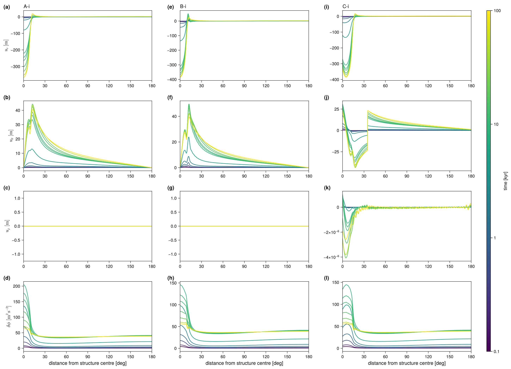
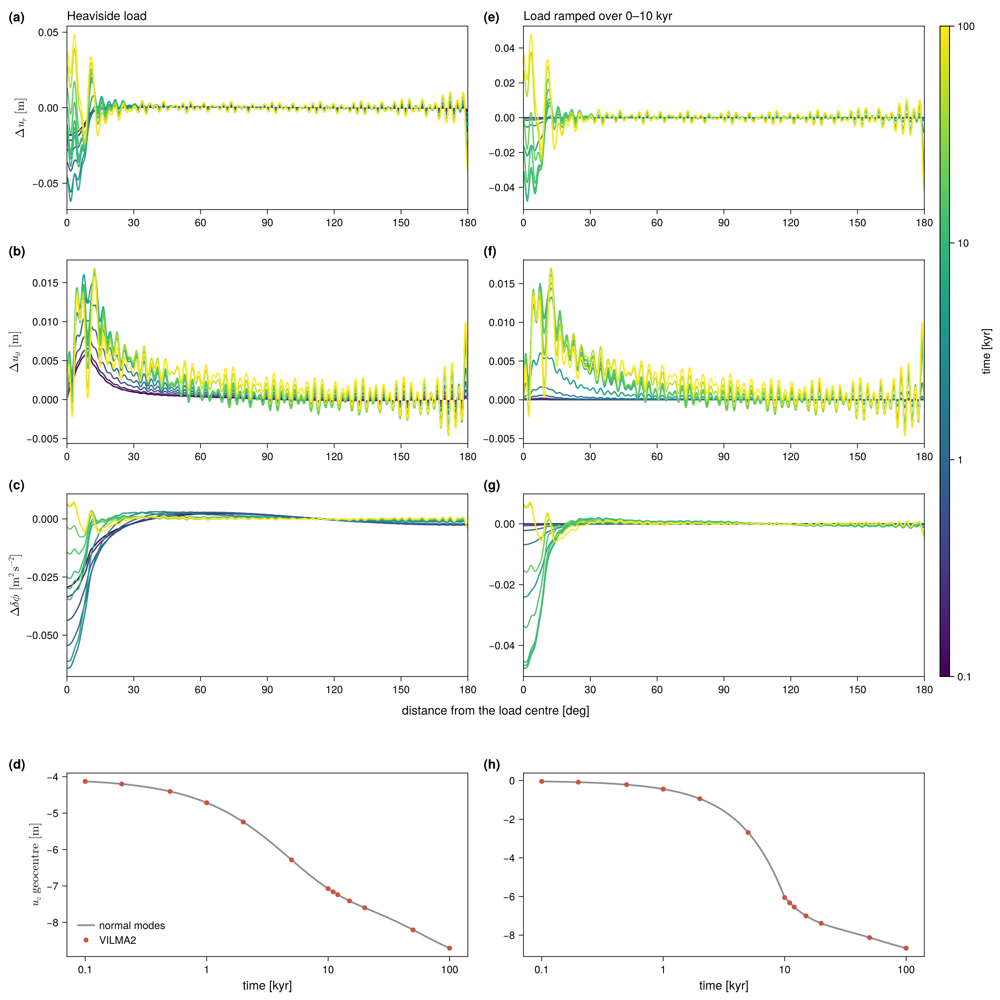
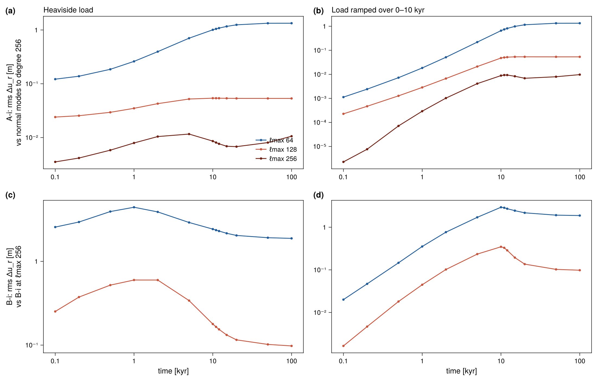

::: {.callout-warning appearance="minimal"}
**Pre-publication page.** This page is not linked from the navigation and is
excluded from the site search. It is reachable by direct link only.
:::

::: {.callout-note appearance="minimal"}
**Reference:** community benchmark of GIA codes with laterally heterogeneous
earth structure, setup note by Klemann et al. [@Klemann2022setup]
(`doc/refs/klemann-visc3d-benchmarks-setup.pdf`). **Driver:**
`bench_visc3d` (not in `make check`). **Status:** 🔧 A-i, B-i and C-i run to
100 kyr at $\ell_\max$ = 128, A-i and B-i also at 64 and 256 (model f0c4678,
albedo). No reference solutions are published yet, so the
driver has no pass/fail; A-i is checked against its exact normal-mode solution.
:::

::: {.callout-important}
**What validates the 3-D path today.** The 3-D viscosity path is cross-checked
against two things only: VILMA1, on the last deglaciation
([deglaciation page](deglaciation.qmd)), and the low-viscosity-zone case of
Weerdesteijn et al. (2023) [@Weerdesteijn2023] ([LVZ page](lvz.qmd)). No
multi-code 3-D benchmark has been run yet. This page describes the setup that
VILMA2 contributes to such a benchmark. It produces the protocol files and
compares them with nothing.
:::

The benchmark follows @Spada2011 and @Martinec2018 but adds a
**low-viscosity column** under or near an ice load. It isolates the effect of
lateral viscosity on vertical and horizontal displacement, on the gravitational
potential, and on geocentre motion. The note defines compressible and
incompressible variants; VILMA2 is incompressible, so only **A-i, B-i and C-i**
are run.

## Setup

**Earth.** M3–L70–V01 (as for the [Love numbers](love-numbers.qmd)), with
interfaces added at 60 and 220 km depth so that FE nodes bound the structure.
The 60–70 km part of the lithosphere is made Maxwell with
$\eta = 10^{30}$ Pa s, because an elastic element cannot carry a lateral
viscosity. This split changes the test-A result by $\lesssim 4\times10^{-9}$
relative.

**Structure.** A rotationally symmetric column over 60–220 km depth, centred at
$(\vartheta_S, \lambda_S)$, with a smoothed-Heaviside profile in the angular
distance $\vartheta$ from its centre:

$$
\log_{10}\eta = \log_{10}\eta_\text{ref}
  + \left(\log_{10}\eta_c - \log_{10}\eta_\text{ref}\right) H(\vartheta),
\qquad
H(\vartheta) = \left[1 + e^{2(\vartheta-\vartheta_w)/d}\right]^{-1},
$$

with half-width $\vartheta_w = 12°$, edge width $d = 1°$ and centre viscosity
$\eta_c = 10^{18}$ Pa s. That is a drop of 3 orders of magnitude in the mantle
and 12 in the 60–70 km lithosphere, which the note asks to reach the same centre
value.

**Grid.** The Gauss grid has $2\ell_\max + 2$ latitudes. It has $4\ell_\max$
longitudes for C and 2 for the axisymmetric A and B.

**Load.** A cap of radius $\alpha = 10°$ with a square-root profile,

$$
\sigma(\vartheta) = \rho_\text{ice}\, h_L
  \sqrt{\frac{\cos\vartheta - \cos\alpha}{1 - \cos\alpha}},
\qquad h_L = 1500\ \mathrm{m},\ \rho_\text{ice} = 931\ \mathrm{kg\,m^{-3}},
$$

centred at $(\vartheta_L, \lambda_L)$. Its SH coefficients are exact: Gauss–Legendre
quadrature in $s$ with $\cos\vartheta = \cos\alpha + (1-\cos\alpha)s^2$ turns the
square-root edge into a polynomial, and the addition theorem rotates the cap to
its centre. Two forcings: **heav** (load applied at $t=0$) and **ramp**
(thickness linear over 0–10 kyr, then held). No ocean, no rotation.

| test | structure $(\vartheta_S, \lambda_S)$ | load $(\vartheta_L, \lambda_L)$ | geometry |
|---|---|---|---|
| A-i | none (S0) | (0°, 0°) | 1-D reference |
| B-i | (0°, 0°) | (0°, 0°) | axisymmetric, structure under load |
| C-i | (35°, 25°) | (30°, 25°) | off-axis, structure and load overlap |

A and B are axisymmetric and run with $m_\max = 0$; C runs the full spectrum.

**Time stepping.** Explicit (`fe`) memory update. $\Delta t$ is set by the
Maxwell ceiling at $\eta_c$ ($\mu\Delta t/\eta_c \le 1$), rounded to divide
100 yr, which gives $\Delta t = 0.448$ yr. All three tests use the same
$\Delta t$, so their differences come from the structure alone.

### Readings of the setup note

The note is a draft and a few points had to be interpreted:

- The half-width of the structure is 12° in the text and 10° in the table;
  12° is used.
- $\Delta\eta = -10^3$ is read as a factor $10^{-3}$ in log space (the formula
  in the note gives $\eta = 0$ for S0, $\Delta\eta = 0$).
- The prose swaps the ice and water densities; the table's values
  ($\rho_\text{ice} = 931$, $\rho_w = 1000$) are used.
- "$\vartheta_S$ and $\alpha$ are increased" in the ramp is read as the
  @Spada2011 ramp: the ice **thickness** grows linearly, the geometry is fixed.
- The model's own constants (seconds per year, $G$) are used; they differ from
  the note's by $\lesssim 10^{-4}$ relative.

## Output

At the epochs 0.1, 0.2, 0.5, 1, 2, 5, 10, 11, 12, 15, 20, 50 and 100 kyr, the
fields are evaluated at points every 0.1°. The points lie along the great circle
from the structure centre through the load centre to the antipode. For A and B,
where both centres sit at the pole, that circle is the $\lambda = 0$ meridian.
The files follow the protocol (tab-delimited, `#` header):

- `disp_VILMA2_<T>-i_<forcing>.txt`: longitude, latitude, distance along the
  section [deg], time [kyr], $u_r$, $u_\vartheta$, $u_\varphi$ [m] and
  $\delta\phi$ [m² s⁻²].
- `gcm_VILMA2_<T>-i_<forcing>.txt`: time [kyr] and the geocentre offset
  $u_\text{gcm} = u_\text{CF} - u_\text{CM}$ ($x, y, z$ [m]).

The driver does not compare these files with a reference, and it returns no
pass or fail. The only check it prints is the load mass, from the degree-0
coefficient, next to its closed form. It also prints $u_r$ at the structure
centre at each output epoch.

Conventions:

- **Frame.** Displacements are in the CM frame (`deg1_frame = "cm"`). Then
  $u_\text{gcm} = u_\text{CF}$, the surface mean of the displacement vector,
  $(U_1 + 2V_1)/3$ in Cartesian components [@Blewitt2003].
- **Potential.** $\delta\phi = -F(a) = g N$, which includes the load's own
  potential.
- **Horizontal displacement** is spheroidal plus [toroidal](../physics/toroidal.qmd).
  Its components are in the local geographic basis, so $u_\vartheta$ changes
  sign where the section crosses a pole. At the pole itself, the basis is that
  of the meridian the section runs along.

## Running

The run config is `examples/bench_visc3d.nml`. Its `&benchv3d` group sets `test`
(`A`/`B`/`C`), `forcing` (`heav`/`ramp`) and `time_end` [years]. From `&vilma`
only `lmax`, `l_toroidal` and `visc_3d_tol` are read. The example config sets
`lmax = 128` and `l_toroidal = .true.`, and `visc_3d_tol` keeps its default. The
earth model, memory scheme, degree-1 frame and grid are fixed by the benchmark.
The protocol files are written to the working directory.

Build, then submit all six cases as one runme ensemble (runme alias
`visc3d`):

```bash
make bench_visc3d openmp=1
runme -o runs/bench_visc3d -e visc3d -n examples/bench_visc3d.nml --omp 64 \
      -p benchv3d.test=A,B,C benchv3d.forcing=heav,ramp -s
```

Use `-r` instead of `-s` to run locally, and add e.g. `vilma.lmax=64
benchv3d.time_end=2000` for a short test. The validation suite runs the
benchmark as its stage `B` and draws the figures and tables on this page
(`validation/README.md`):

```bash
cd validation
./run.sh B                          # A-i, B-i, C-i, both forcings, l_max 128
LMAX=64 CASES="A B" ./run.sh B      # truncation series; also LMAX=256
./run.sh submit reduce analyse      # tables/blockB.md and the figures
```

**Restart.** A run longer than one job is split into segments. `restart_out`
saves the memory state at `time_end`, and `restart_in` resumes from it. Time is
counted in global steps, so a chain of segments reproduces one uninterrupted run
byte for byte. Each segment appends to the protocol files and skips the epochs
already written. A restart from another test, forcing, $\ell_\max$ or
$\Delta t$ is refused. For 20-kyr segments:

```fortran
&benchv3d  test = "C"  forcing = "heav"  time_end = 40.0e3
           restart_in = "restart_20kyr.nc"  restart_out = "restart_40kyr.nc" /
```

The step count is set by $\eta_c$: 223 000 steps to 100 kyr. At
$\ell_\max = 64$ with 8 threads (laptop), a C run costs about 53 ms per step,
or about 3.3 h. A and B, with $m_\max = 0$, take minutes. The target
resolution is $\ell_\max = 128$, where C takes about 20 h on 64 threads. That
is why C runs in restart segments.

## Result

All six cases (A-i, B-i, C-i, each with heav and ramp forcing) have been run to
100 kyr at $\ell_\max = 128$ with the toroidal field on, as five 20-kyr
restart segments each. A and B were also run at $\ell_\max = 64$ and 256. The
load mass matches the closed form exactly. The numbers are from
`validation/tables/blockB.md` (model f0c4678, albedo) and equal those of the
earlier model 907bc74 to the printed digits.

| test | forcing | $u_r$ at load, 0.1 kyr | 10 kyr | 100 kyr | max $u_r$ at 100 kyr | $\lvert u_\text{gcm}\rvert$ at 100 kyr |
|---|---|:-:|:-:|:-:|:-:|:-:|
| A-i | heav | $-39.35$ m | $-307.76$ m | $-366.67$ m | 17.90 m | 8.709 m |
| B-i | heav | $-67.91$ m | $-357.80$ m | $-386.07$ m | 20.76 m | 8.769 m |
| C-i | heav | $-67.11$ m | $-360.55$ m | $-386.46$ m | 15.40 m | 8.829 m |
| A-i | ramp | $-0.36$ m | $-219.71$ m | $-365.64$ m | 18.02 m | 8.676 m |
| B-i | ramp | $-0.55$ m | $-309.13$ m | $-385.60$ m | 21.02 m | 8.739 m |
| C-i | ramp | $-0.53$ m | $-308.11$ m | $-386.02$ m | 15.49 m | 8.797 m |

: Vertical displacement at the load center, the peripheral bulge and the geocentre offset. {#tbl-visc3d}

The low-viscosity column under the load (B-i) deepens the depression at
0.1 kyr by about 70 % and at 100 kyr by about 5 %. These numbers have no
reference yet.

**Test A-i against an exact solution.** A-i has no lateral structure, so its
exact solution is the normal-mode response of M3–L70–V01 at the same
truncation. VILMA2 matches it to within 0.05 m in $u_r$ (of 39–367 m at the
load center), 0.016 m in $u_\vartheta$ and 1.6 mm in the geocentre offset, at
0.1, 1, 10 and 100 kyr and for both forcings.

**Truncation.** The rms difference of $u_r$ along the section between A-i and
the normal-mode solution to degree 256 is 1.3 m at $\ell_\max = 64$,
0.05 m at 128 and 0.01 m at 256 (100 kyr, heav). For B-i against its own
$\ell_\max = 256$ run it is 1.9 m at 64 and 0.1 m at 128. At
$\ell_\max = 64$ the 1° edge of the structure is not resolved and B-i shows
Gibbs ringing with a period of about 3°.

**Cost.** At $\ell_\max = 128$ with the toroidal field on and 64 threads
(albedo), C-i took 19.3 h (heav) and 20.0 h (ramp) to 100 kyr, 3.5–4.2 h per
20-kyr segment. A-i and B-i, with $m_\max = 0$, took 0.07 h and 0.16 h. On
levante (model 907bc74), C-i took 10.5 h with the toroidal field off and
18.6 h with it on, so the toroidal field costs a factor of 1.8.

## Figures

The figures show VILMA2 only. A comparison with other codes follows once their
results are available.

{#fig-visc3d-sections-heav}

{#fig-visc3d-sections-ramp}

![Geocentre motion $u_\text{gcm} = u_\text{CF} - u_\text{CM}$ ($x$, $y$, $z$ components [m]) against time for tests A-i, B-i and C-i. VILMA2 only, with no reference solution.](figures/visc3d-geocentre.png){#fig-visc3d-geocentre}

{#fig-visc3d-A-normal-mode}

{#fig-visc3d-lmax}
